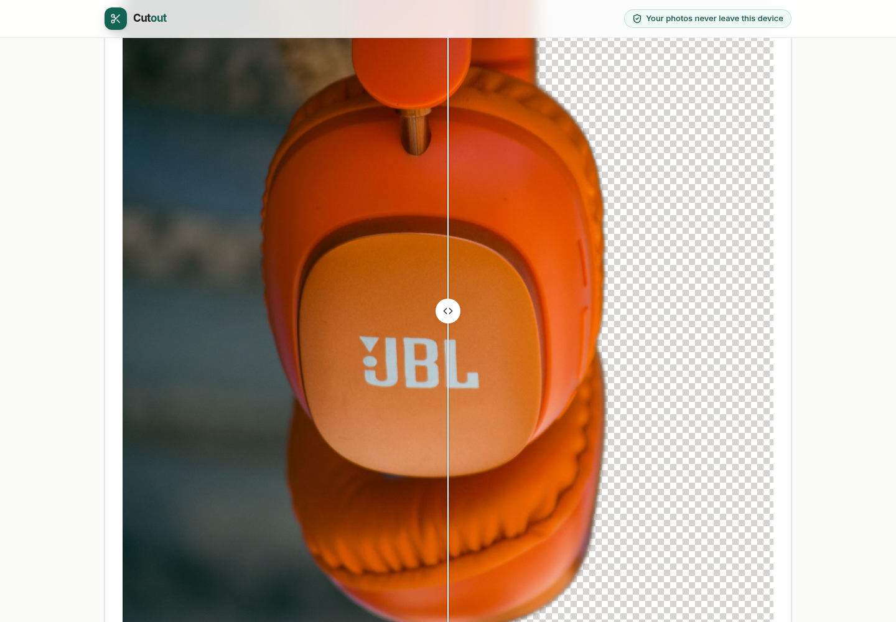
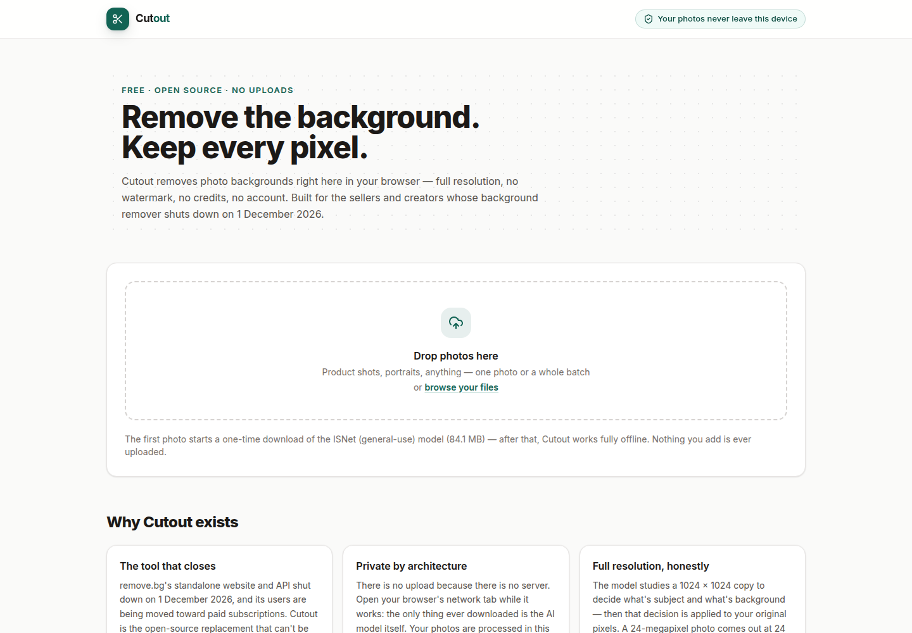
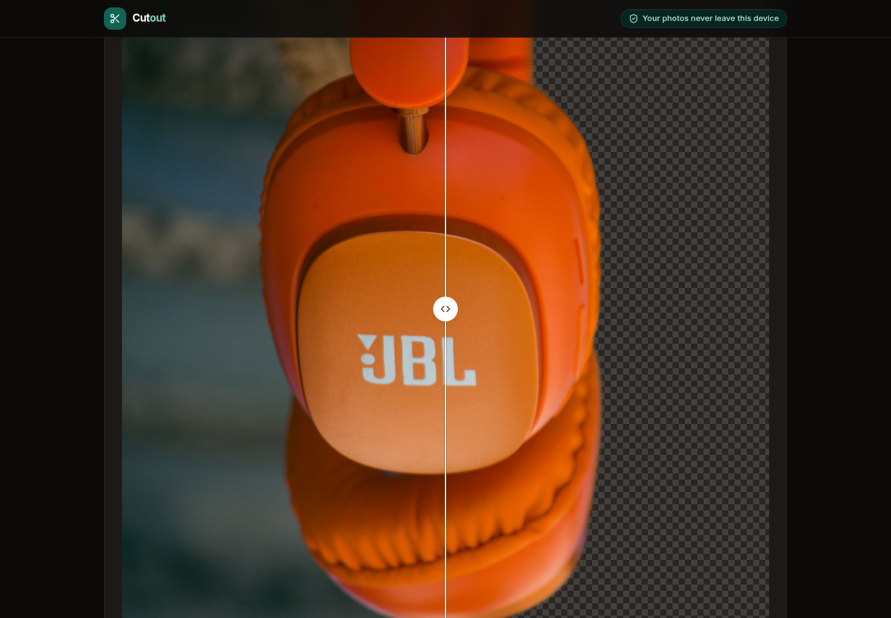
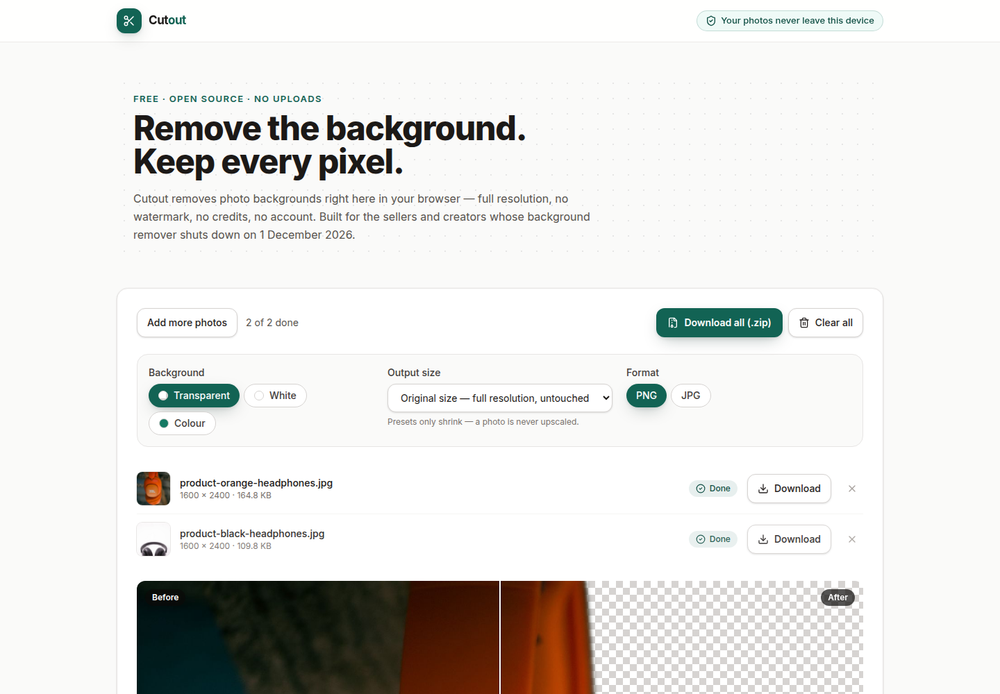

# Cutout

[](LICENSE)

**Free background removal that runs 100% in your browser.** Drop in a photo — or a
batch of fifty product shots — and get a full-resolution cut-out back. No uploads,
no watermark, no credits, no account. Your photos never leave your device.

> Most background removers work like this: you upload your photo, it sits on their
> server, and the full-resolution result sits behind a subscription. Cutout works
> like this: an AI model runs in this browser tab, on your machine, and the result
> is yours at the resolution you started with.



## Screenshots

<!-- Screenshots are standalone full-width images on purpose: images inside
     markdown tables do not render in the GitHub mobile app. -->

**The tool, ready for a photo** — one drop zone, no sign-up wall:



**Dark mode** — the same result, following the system theme:



**Batch mode** — two product photos done, shared settings, one zip for everything:



## What it does

- **Single photos** — drag-and-drop or browse, watch a before/after slider, download.
- **Batch mode** — add many photos; each is processed in turn with its own status.
  One bad file fails alone, with the reason shown, and never kills the batch.
- **Backgrounds** — transparent, white, or any colour you pick.
- **Marketplace sizes** — Amazon (2000px), eBay (1600px), Etsy (2700px) and
  Shopify (2048px) longest-edge presets. Presets only ever shrink; a photo is
  never upscaled.
- **Formats** — transparent PNG, or JPG/PNG flattened onto the chosen background
  (JPG can't hold transparency, so it flattens onto white — the UI says so).
- **Download all as one zip**, with duplicate file names safely de-duplicated.

## How it works

1. The first photo triggers a one-time download of the segmentation model
   (88 MB), which your browser caches — from then on, **Cutout works offline**.
2. The model studies a 1024 × 1024 copy of your photo and predicts an alpha
   mask. Inference runs in a Web Worker, on your **GPU (WebGPU)** when the
   browser offers one and on **CPU (WASM)** otherwise, with a single-thread
   fallback on pages without cross-origin isolation.
3. The mask is upscaled to your photo's real size, lightly feathered, and
   applied to the **original pixels**. The photo itself is never resized by
   the cut-out step — a 24-megapixel photo comes out at 24 megapixels.

### The model — and why this one

Cutout runs **ISNet (general-use)**, a dichotomous image segmentation model
from the [DIS project](https://github.com/xuebinqin/DIS) (Apache-2.0), using the
ONNX conversion published by IMG.LY at
[imgly/isnet-general-onnx](https://huggingface.co/imgly/isnet-general-onnx)
(MIT licence on the model repo), pinned to revision
`440dea96dd4a3b06bbbf5abec3e26569dd7ec49f`. Inference uses
[onnxruntime-web](https://onnxruntime.ai/) (MIT) — deliberately **not** the
AGPL-licensed `@imgly/background-removal` wrapper.

The newer BiRefNet-lite (also MIT) was evaluated first and rejected on evidence:
in a real browser its transformer graph exhausts WASM memory at inference time
(`std::bad_alloc`) in every WASM configuration tested, while ISNet's
convolutional graph runs reliably on both WASM and WebGPU at the same
1024 × 1024 input. ISNet's fp16 weights were verified to produce masks
identical to its fp32 weights on WASM, so a single 88 MB file serves both
providers. MODNet was rejected for a different reason: it is specialised for
portraits, and the core audience here is product photography.

## Why Cutout exists

remove.bg's standalone website and API shut down on **1 December 2026**, and
its users are being moved toward paid subscriptions and another company's
editor. Cutout is the open-source replacement that can't be shut down,
paywalled or acquired: MIT-licensed code, no server, nothing to switch off.

## Privacy

There is no backend, no account system, no analytics and no upload endpoint —
the only network requests the app ever makes are for its own static files and
the one-time model download from Hugging Face. Verify it yourself: open your
browser's network tab and watch while it works.

## Development

You need Node.js 20 or newer (developed on Node 24).

```bash
npm install     # also copies the onnxruntime-web WASM builds into public/ort/
npm run dev     # local dev server with cross-origin-isolation headers
npm test        # unit tests for the pure logic (mask maths, sizing, queue, zip)
npm run lint    # ESLint
npm run build   # typecheck + production build into dist/
```

Notes for contributors:

- The pure logic lives in `src/lib/` and is unit-tested; the ONNX engine
  (`engine.worker.ts` + `engine.ts`) is verified end-to-end in a real browser
  against the production build before release.
- `public/_headers` ships the COOP/COEP headers the threaded WASM build needs
  for hosts that support them (Netlify-style). Without them the app still
  works — inference just runs on one thread.
- Very large photos (over 120 megapixels) are refused with an explanation:
  canvas buffers that size get tabs killed, and silently downscaling a user's
  photo would break the full-resolution promise.

## Licence

Cutout is [MIT](LICENSE) © 2026 Ram Chauhan. The model and runtime carry
their own permissive licences, listed under "The model" above.
